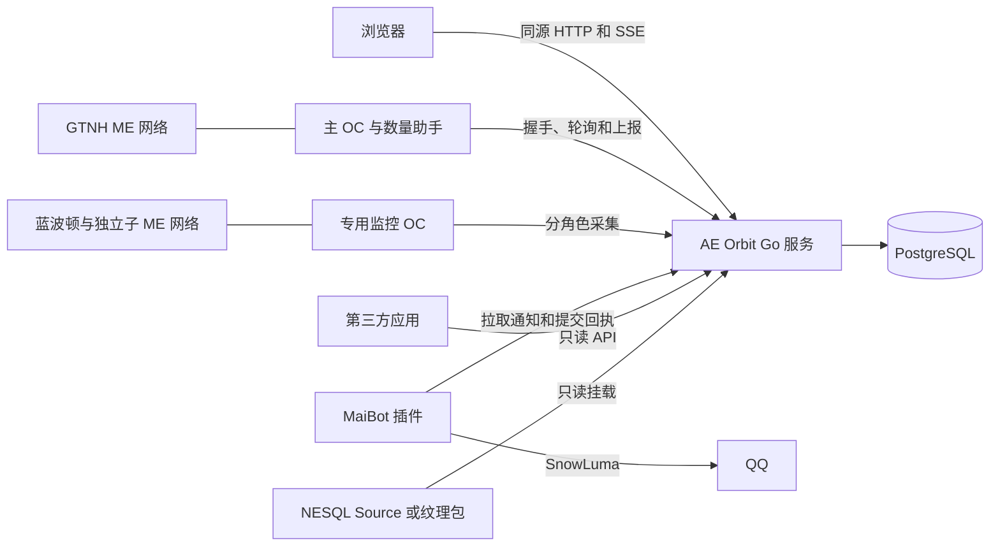

# AE Orbit 技术架构

AE Orbit 当前以单个 Go 服务运行。它内嵌同源网页和 OC 安装文件，使用 PostgreSQL 保存成员、库存观测、合成任务、插件设置和历史。游戏内 OC 主动连接服务，游戏服务器无需接收入站 HTTP 请求。

## 数据与执行边界

| 领域 | 状态来源与关键约束 |
| --- | --- |
| 库存与 NESQL | NESQL 提供候选身份、名称、说明和纹理。数量、配方和 CPU 状态来自 OC。未知、过期和确认归零是不同状态。物品身份包含 registry、meta 和适用的 NBT。物品件数、流体 mB 和源质量分开统计。 |
| 采集 | 协作桥接器先握手上报角色与能力，再按服务器组共享预算领取读取任务。主 OC 负责配方和合成，数量助手用于分担数量读。`exact_only` 关闭主网整网扫描及事件订阅。重复批次以会话和序号核对。 [协作协议](../contracts/protocol-v2.md) |
| 合成 | 后端先保存生产清单与幂等回执，再按容量逐步派发。主 OC 在 AE 执行并记录本地日志。副作用结果不明时进入 `needs_review`，由成员核对后结案，禁止丢掉原请求键重新下单。 [生产任务契约](../contracts/production-jobs.md) |
| CPU | 基础快照由主 OC 上报。合成过程使用独立的查看租约采集 active、pending、stored。三栏按轮次更新，旧会话结果不能用于当前任务。 [CPU 过程契约](../contracts/cpu-details.md) |
| 历史 | 主页的 24 小时趋势保存在当前浏览器。独立的库存历史使用 PostgreSQL，记录变化及分钟、小时、日汇总。蓝波顿和子网各自采样、分段和保留。 [库存历史](inventory-history.md) |
| 插件与 QQ | 蓝波顿、子网使用专用 OC。QQ 消息先进入 PostgreSQL `qq_outbox`，MaiBot 领取后通过 SnowLuma 发送，并以本地 SQLite 保存发送尝试与回执。发送结果不明时保留记录供核对。 [QQ 联动](qq-notifications.md) |

主网采集默认约束以部署配置和握手能力为准。独立小子网的直接发现经过 AE 原生存储清单接口，仅用于与主网隔离的小网络。Lua 的数量和包体限制在部分原生回调返回后才生效。 [子网监控](subnet-monitoring.md)

网页的 SSE 通知用于触发缓存失效和重新读取。浏览器普通翻页、第三方只读 API 和 QQ 库存关键词查询读取后端已有观测。主动单物品刷新、CPU 过程面板等操作才会形成额外的有界采集需求。 [HTTP 契约](../contracts/openapi.yaml) [第三方只读 API](api-integrations.md)

## 凭据与作用域

| 入口 | 身份范围 |
| --- | --- |
| `/api/v1/` | 成员或管理员。浏览器通过会话 Cookie 登录，写请求校验来源和 CSRF。网络查询和合成分别检查权限。 |
| `/bridge/v1/`、`/bridge/v2/` | 主网设备令牌，绑定具体设备与网络。 |
| `/bridge/monitor/`、`/bridge/subnet/` | 专用监控令牌，按服务器组、用途和采集器身份校验。 |
| `/bridge/qq/v1/` | 服务器组的 MaiBot 连接凭据，群授权由 MaiBot 同步。 |
| `/api/integration/v1/` | 成员创建的只读应用密钥，受密钥的资源授权和创建者当前访问权限共同约束。 |

## 从哪里改代码

| 改动 | 入口 |
| --- | --- |
| 启动、环境变量、周期任务 | [服务入口](../cmd/ae-orbit/main.go)、[配置解析](../internal/config/config.go) |
| 路由、权限、协议字段 | [HTTP 路由](../internal/api/routes.go)、[鉴权](../internal/api/auth.go)、[协议类型](../internal/protocol/types.go)、[OpenAPI](../contracts/openapi.yaml) |
| 库存采集与查询 | [协作读取](../internal/store/cooperative_reads.go)、[采集事务](../internal/store/cooperative_inventory.go)、[归组分页](../internal/store/grouped_items.go)、[NESQL 目录](../internal/catalog/catalog.go) |
| 订单及历史 | [生产任务 API](../internal/api/production_jobs.go)、[任务持久化](../internal/store/production_jobs.go)、[派发](../internal/store/production_job_admission.go)、[库存历史](../internal/store/inventory_history.go) |
| 网页 | [页面装配](../web/src/app.mjs)、[请求封装](../web/src/api.mjs)、[库存页生命周期](../web/src/inventory-view.mjs)、[库存分页请求与缓存](../web/src/inventory-pages.mjs)、[前端构建](../scripts/build_web.mjs) |
| OC | [命令入口](../oc/bin/ae-orbit.lua)、[协作采集](../oc/lib/aeorbit/cooperative.lua)、[ME 适配](../oc/lib/aeorbit/adapter.lua)、[蓝波顿](../oc/lib/aeorbit/monitor.lua)、[子网](../oc/lib/aeorbit/subnet.lua)、[安装器](../oc/install.lua) |
| 插件与投递 | [插件目录](../internal/plugins/catalog.go)、[监控 API](../internal/api/monitoring.go)、[子网 API](../internal/api/subnets.go)、[QQ 投递事务](../internal/store/qq_bridge.go)、[MaiBot 插件](../integrations/maibot-ae-orbit/plugin.py) |
| 数据迁移 | [启动迁移器](../internal/store/migrate.go)、[迁移目录](../internal/store/migrations/) |

修改跨组件功能时按对应数据链路验证。例如改子网告警，先检查 OC 样本的有效期，随后检查规则与通知写入事务，最后验证 MaiBot 的回执。操作步骤和验证命令分别见 [运维手册](operations.md) 和 [开发与贡献](../CONTRIBUTING.md)。
